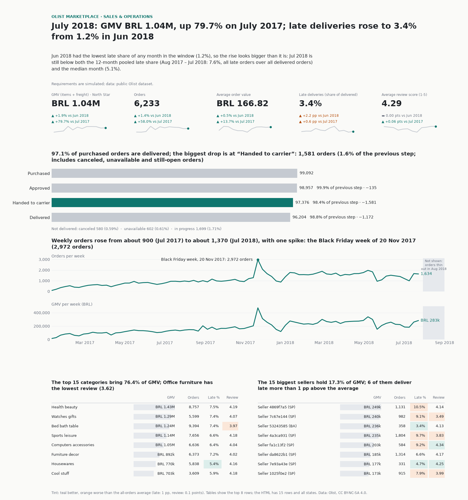

# Product analytics: SQL on Olist + a full A/B test on Criteo

[Русская версия](README.ru.md)

Author: Anastasia Kalugina

Three parts, one repository:

1. **SQL analytics** of a Brazilian online marketplace (Olist, about 100k orders):
   11 business questions, each answered by one SQL file (DuckDB, written in a
   PostgreSQL-compatible subset).
2. **A/B-test workflow** on an advertising benchmark (Criteo Uplift v2.1, about 14M
   users): design and power calculation before the analysis, sample ratio check,
   balance checks, z-test, bootstrap, CUPED, multiple-comparison correction, a
   sensitivity analysis and limitations. The data was distorted by its owner on
   purpose, so this part is about method and pitfalls, not about ad effectiveness.

3. **A sales/operations dashboard** for a simulated "Head of Sales & Operations" of
   the same marketplace, built by the "requirements first" method: a requirements
   document, one SQL query per dashboard block, one interactive HTML file.

No machine learning here on purpose: the point is queries and experiment statistics.

## Status

| Part | Status |
|---|---|
| Olist SQL (11 queries), notebook 01 | done, executed, outputs saved |
| Criteo A/B (v2.1, 13,979,592 users), notebooks 02 and 03 | done, executed on the full data, outputs saved |
| Olist dashboard (spec, 6 SQL blocks, HTML + PNG) | done: `python -m pa.dashboard` rebuilds it from the local database; requirements are simulated |
| Unit tests for stats, SQL and the dashboard, CI | done: 131 tests pass, `ruff check .` clean |

Notebook 02 (design) was written before the outcomes were read; its choices are in
`docs/preregistration.json` and were not changed afterwards. Notebook 03 adds a
clearly marked post-hoc section after a stress test of the analysis.

## Key numbers (Olist, notebook 01)

Every number comes from the saved output of `notebooks/01_olist_sql_analytics.ipynb`.

| Finding | Number | Where |
|---|---|---|
| Real customers vs `customer_id` rows | 96,096 people in 99,441 rows; 2,997 people have several `customer_id`s | section 3, cell [5] |
| Growth | monthly GMV 0.14M BRL (Jan 2017) to 1.17M (Nov 2017), then flat at about 1.0-1.16M in 2018 | Q2, cell [6] |
| Late delivery | 6.79% of delivered orders (6,531 of 96,203) arrive late; average review 2.27 vs 4.29 for on-time | Q4, cell [9] |
| Repeat purchase | 3.03% of customers order twice (2,874 of 94,703); median 28 days to the second order | Q7, cell [13] |
| Seller concentration | 537 of 3,029 sellers (17.7%) give 80% of revenue | Q9, cell [15] |
| Black Friday | 2017-11-24: 1,176 orders, 5.7 times the weekly average before it | Q10, cell [17] |

Figures (computed from Olist data, CC BY-NC-SA 4.0, credit: Olist):


## What the A/B part shows (Criteo Uplift v2.1, notebooks 02 and 03)

Read this first: Criteo **deliberately distorted the incrementality level** of this
dataset (the dataset page says the data "has been sub-sampled non-uniformly so that
the original incrementality level cannot be deduced") and re-sampled every
underlying test to the same treatment ratio. So the numbers below illustrate
**methods**; they are not a measurement of how effective ads are.

- **Full workflow** on 13,979,592 users: pre-registered design with power and an A/A
  simulation, sample ratio check, balance checks, z-test, bootstrap, CUPED, Holm,
  and a post-hoc sensitivity analysis.
- **Key finding (caught by the balance check):** treatment is **not independent of
  the features** in the released sample. The chi-square test rejects independence
  of treatment and category for 8 of 8 categorical features, and the treatment share
  differs between quartiles of f0 (0.8457 to 0.8574) (notebook 03, section 3.2).
  The sample ratio check cannot see this, because the split was forced to 85%.
- Treated users visit more often: **4.85% vs 3.82%** (notebook 03, section 4).
  The naive difference is sensitive to how one adjusts: post-stratification by each
  categorical feature, by f0 quartiles, and linear adjustment give estimates from
  **0.788 to 1.002 percentage points**, all positive, all smaller than the naive
  one. The Mantel-Haenszel odds ratio stays between **1.233 and 1.292** (crude
  1.285) (section 7).
- So the **sign is robust, the size is not identifiable**. The very narrow
  confidence intervals describe sampling noise only, not bias.

Figures (computed from Criteo data, CC BY-NC-SA 4.0, credit: Criteo AI Lab):


## Part 3: dashboard (Olist sales and operations)

**What and why.** A one-page dashboard for a *simulated* "Head of Sales & Operations".
I followed the order a BI analyst works in: first the decisions the page must support
and one agreed definition per metric
([docs/dashboard_spec.md](docs/dashboard_spec.md), also in
[Russian](docs/dashboard_spec.ru.md)), then the SQL for each block
(`sql/dashboard/`), only then the picture. The client, the interview and the
requirements are invented and marked as such; the data and every number are real
Olist figures. The spec also lists the data-quality problems I checked before
drawing anything (for example 99,092 `customer_id`s but only 95,774 real customers in
the window, and a data tail that thins out in the last days of August 2018).

The page opens with a one-sentence headline and a "so what" line (both written from
the query results at build time), then follows a fixed order: KPI cards with a
12-month sparkline and arrows, funnel, weekly trend with the Black Friday week and the
thin data tail annotated, tables with inline bars and two tinted cells per row
(categories, states, sellers: the analogue of a "per-manager" table), and a footer
with source, licence and window dates. Greys for context, one teal accent, orange only
for bad, an arrow and a sign next to every delta, no pie charts. Why it looks like
this, with sources: [docs/dashboard_design.md](docs/dashboard_design.md) (also in
[Russian](docs/dashboard_design.ru.md)).



**[Open the interactive dashboard](https://nastkalugi3.github.io/product-analytics-sql-ab/reports/dashboard/olist_dashboard.html)** (GitHub Pages).

*Preview drawn with matplotlib. The source file is
[`reports/dashboard/olist_dashboard.html`](reports/dashboard/olist_dashboard.html);
Plotly is loaded from a CDN, so without internet the cards and tables render but
the funnel and trend charts do not. Figures: computed from Olist data,
CC BY-NC-SA 4.0, credit: Olist.*

Numbers on the page (July 2018, the last complete month, from the generated output):

| Card | July 2018 | vs June 2018 | vs July 2017 |
|---|---|---|---|
| GMV (North Star) | BRL 1.04M | +1.9% | +79.7% |
| Orders | 6,233 | +1.4% | +58.0% |
| Average order value | BRL 166.82 | +0.5% | +13.7% |
| Late deliveries | 3.4% of delivered | +2.2 pp | +0.6 pp |
| Average review score | 4.29 | 0.00 | +0.06 |

June 2018 was unusually quiet for late deliveries (1.2% of delivered orders, the lowest
month in the window), so July's +2.2 pp looks orange; July itself (3.4%) is below the
12-month average of 7.6% (purchases from August 2017 to July 2018).

Other numbers: the purchase funnel over the whole window goes 99,092 purchased, 98,957
approved (99.9%), 97,376 handed to the carrier (98.4% of approved), 96,204 delivered
(98.8% of handed over); 580 orders were canceled and 602 were unavailable. The peak
week is the one starting 2017-11-20 with 2,972 orders. Late share by state ranges
from 2.8% (Amazonas) to 21.5% (Alagoas); the average of all orders is 6.79%.

**Why July and not August 2018.** August 2018 is a full month on the calendar, but
daily orders fall from 256 on 2018-08-20 to 1 on 2018-08-31, so the cards use the last
month that passes a completeness rule (see spec, section 4 and 8).

**Open or rebuild.** `PYTHONPATH=src python -m pa.dashboard` (needs
`data/olist.duckdb` from `python -m pa.data build`) writes
`reports/dashboard/olist_dashboard.html` and the preview PNG (paths can be changed with
`PA_DASHBOARD_DIR` and `PA_FIGURES_DIR`). The generated files are
aggregates and are committed; the data is not. Not built: filters (period, department)
and alerts; they are described in the spec as what a BI tool would add.

## Data and licences

- **Olist Brazilian E-Commerce**, 9 tables, 2016-2018:
  https://www.kaggle.com/datasets/olistbr/brazilian-ecommerce
- **Criteo Uplift Prediction Dataset v2.1**, an advertising benchmark built from
  randomised tests, 13,979,592 users:
  https://ailab.criteo.com/criteo-uplift-prediction-dataset/
  Version 2.1 is used because the first release had a leak (see the erratum). The
  file is taken from the official Criteo mirror on Hugging Face (see `DATA_LICENSE.md`).

Both are CC BY-NC-SA 4.0 (non-commercial, share-alike). The data is **not in this
repository** and must not be added to it; the code is MIT. Details, links and the
required citation are in [DATA_LICENSE.md](DATA_LICENSE.md).

## How to run

```bash
python3 -m venv .venv && source .venv/bin/activate
pip install -r requirements-dev.txt
pytest -q && ruff check .            # tests use tiny fixtures, no downloads
./run_all.sh                         # download, build, execute notebooks, build dashboard
```

Step by step: `PYTHONPATH=src python -m pa.data download` then
`python -m pa.data build` (add `--criteo-sample-frac 0.1` for a 10% sample of
Criteo while experimenting). Then `PYTHONPATH=src python -m pa.dashboard` builds the dashboard.

If Kaggle asks for credentials, download the Olist archive by hand and unzip the
CSV files into `data/raw/olist/` (or put your own `kaggle.json` in
`~/.kaggle/`). The Criteo file goes to `data/raw/criteo/criteo-uplift-v2.1.csv.gz`.

Python 3.13 or 3.14. CI (GitHub Actions) runs ruff and pytest on both; it does not
download data or run notebooks.

## What is in the repository

```
sql/schema/olist_views.sql   helper views and the analysis window
sql/olist/01..11_*.sql       one business question per file
sql/ab/01..05_*.sql          A/B queries on the Criteo parquet file
sql/dashboard/00..06_*.sql   one query per dashboard block
src/pa/                      config, data download/build, DB helpers, statistics,
                             dashboard builder (pa.dashboard)
notebooks/                   01 Olist SQL, 02 A/B design, 03 A/B analysis
docs/dashboard_spec.md       simulated requirements for the dashboard (also in Russian)
reports/dashboard/           generated interactive dashboard (HTML)
tests/                       stats, SQL on hand-made fixtures, dialect check, dashboard
```

## SQL skills: which construct where

| Construct | Files |
|---|---|
| CTEs | all queries |
| `LAG` / `LEAD` | olist/02 (month-over-month), olist/07 (time to the second order) |
| `ROW_NUMBER`, top-N per group | olist/05, olist/07, olist/09 |
| `NTILE` | olist/08 (RFM) |
| cumulative `SUM() OVER` | olist/09 (Pareto) |
| `RANGE` window over dates | olist/10 (7-day average) |
| `date_trunc`, `EXTRACT` (also month difference for cohorts) | olist/02, 03, 05, 06, 07, 08 |
| `FILTER (WHERE ...)` | olist/04, ab/02 |
| `percentile_cont ... WITHIN GROUP` | olist/03, 07, ab/04 |
| anti-join (`LEFT JOIN ... IS NULL`) | olist/01 |
| `UNION ALL` | olist/01, 03, 04, 11 |
| `CASE` | olist/08, 11 |

Only constructs valid in both DuckDB and PostgreSQL are used (no `QUALIFY`, no
`GROUP BY ALL`, no DuckDB list functions). Every file is parsed with `sqlglot` using
the PostgreSQL dialect in `tests/test_sql_dialect.py`. **That checks syntax only**: the
queries were run on DuckDB, not on a PostgreSQL server.

Tests also run every Olist query on a tiny hand-made dataset
(`tests/fixtures/olist_mini`) with numbers checked by hand, including the
`customer_id` trap (one person with two `customer_id`s).

## Method notes for the A/B part

- Unit: the user. Primary metric: visit. Secondary: conversion. The guardrail
  (conversion given visit) is descriptive only, because it conditions on a
  post-treatment outcome.
- Power and minimum detectable effect are computed in notebook 02 before any
  treatment-group result is looked at; the A/A simulation uses the control group only
  (10,000 runs; it validates the test procedure, not the dataset's randomisation).
  The chosen feature and thresholds are in `docs/preregistration.json`. The
  pre-registration is procedural, not blind (the author could not be blind to
  published results on this dataset), and its covariate rule had flaws that
  notebook 02 describes.
- Mann-Whitney is not used (0/1 outcomes are almost all ties); the z-test, a
  bootstrap and CUPED are used. Own formulas, no statsmodels, all unit-tested.
- CACE and business arithmetic (per million users, ROI) are deliberately not
  computed: the sub-sampled data does not support them (notebook 03, section 10).

## Limitations

- **The Criteo data is sub-sampled non-uniformly** (dataset page and arXiv:2111.10106,
  section 3), so it is a benchmark for methods and does not show real ad
  effectiveness. The paper's own relative-uplift figures use a definition that is
  not comparable to ours.
- **Treatment is not independent of the features** in the released sample, so the
  naive difference is biased by an unknown amount. Post-hoc adjustments were not
  pre-registered.
- The data pools several tests and has no test identifier, so a pooled difference
  can hide differences between tests (Simpson's paradox).
- Features are anonymised; eight of them are hashed categories, so segments have no
  business meaning.
- The sample ratio check is uninformative here because the 85% split was forced.
- With millions of users everything is statistically significant; effect size and
  sensitivity matter more than p-values.
- Olist findings are descriptive; they show associations, not causes (for example,
  late delivery goes with low reviews, but this data cannot prove it is the reason).
- Retention on Olist is almost empty because most customers buy once; this is a
  finding about the data, not a bug.

## Licence

Code: MIT (see `LICENSE`). Data and figures: CC BY-NC-SA 4.0 (see `DATA_LICENSE.md`).
