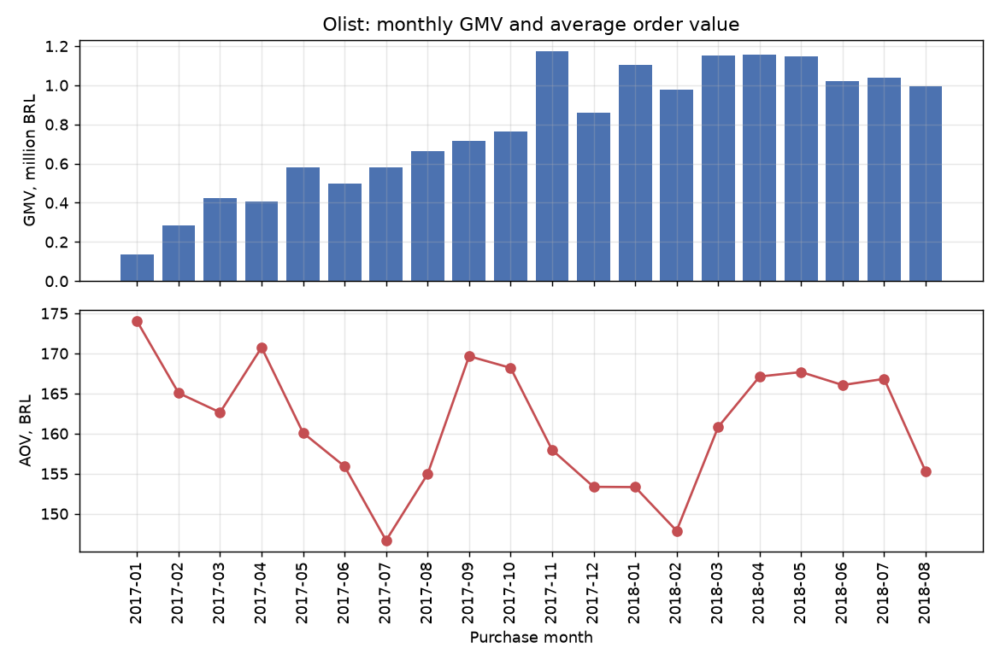
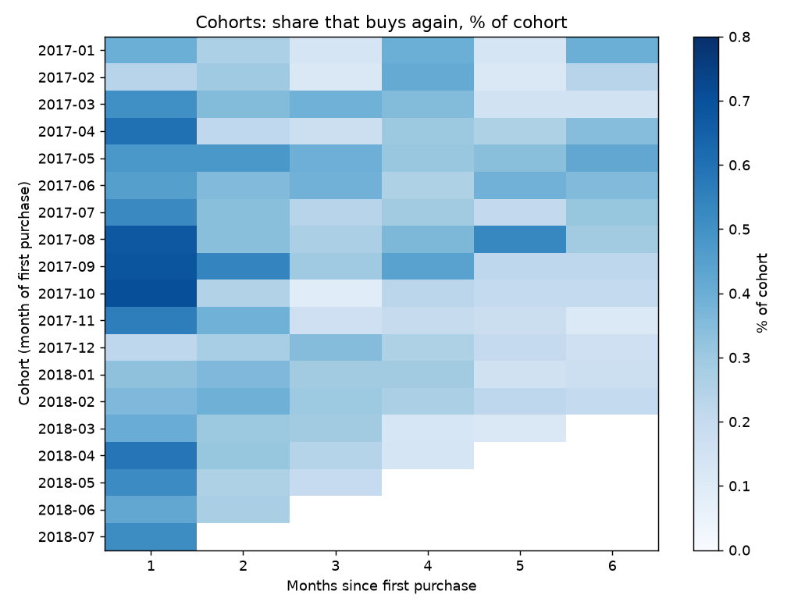
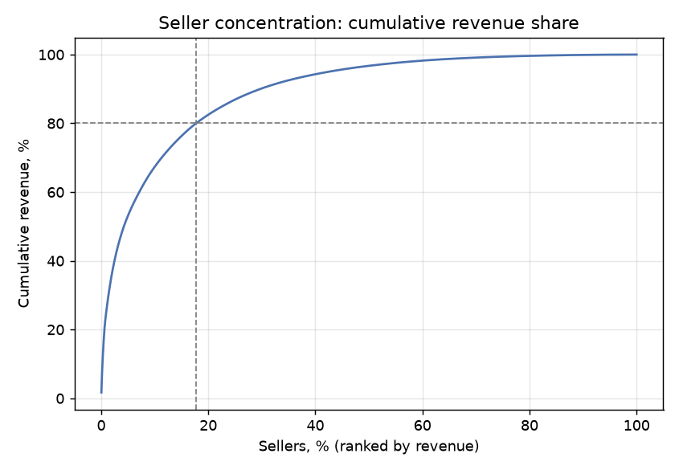
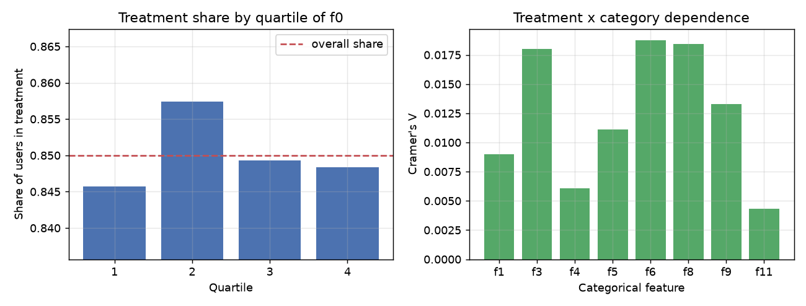
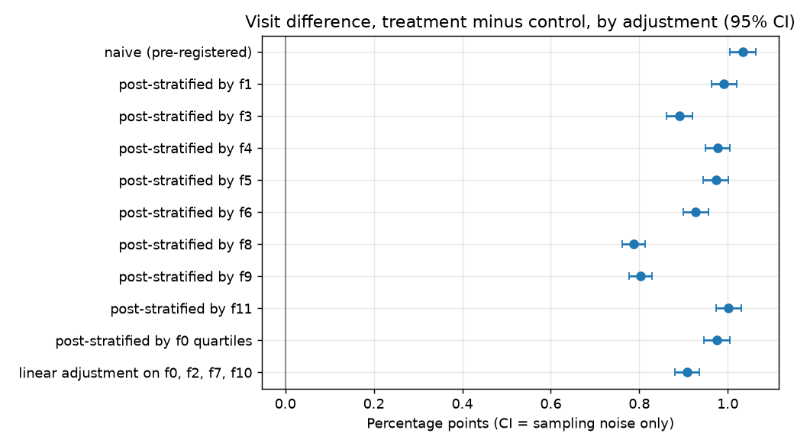

# Продуктовая аналитика: SQL на Olist и полноценный A/B-тест на Criteo

[English version](README.md)

Автор: Анастасия Калугина

Три блока в одном репозитории:

1. **SQL-аналитика** бразильского онлайн-маркетплейса (Olist, около 100 тысяч
   заказов): 11 бизнес-вопросов, на каждый отвечает один SQL-файл (DuckDB, запросы
   написаны на подмножестве, совместимом с PostgreSQL).
2. **Процесс A/B-теста** на рекламном бенчмарке (Criteo Uplift v2.1, около 14 млн
   пользователей): дизайн и расчёт мощности до анализа, проверка соотношения групп,
   проверки баланса, z-тест, бутстрэп, CUPED, поправка на множественные сравнения,
   анализ чувствительности и ограничения. Владелец данных намеренно исказил их, так
   что эта часть про метод и ловушки, а не про эффективность рекламы.

3. **Дашборд продаж и операций** для смоделированного «руководителя отдела продаж и
   операций» того же маркетплейса, собранный методом «сначала требования»: документ
   с требованиями, по одному SQL-запросу на блок дашборда, один интерактивный
   HTML-файл.

Машинного обучения здесь нет специально: проект про запросы и статистику экспериментов.

## Статус

| Часть | Статус |
|---|---|
| Olist SQL (11 запросов), ноутбук 01 | готово, выполнено, выводы сохранены |
| A/B на Criteo (v2.1, 13 979 592 пользователя), ноутбуки 02 и 03 | готово, выполнено на полных данных, выводы сохранены |
| Дашборд Olist (спецификация, 6 SQL-блоков, HTML + PNG) | готово: `python -m pa.dashboard` пересобирает его из локальной базы; требования смоделированы |
| Тесты статистики, SQL и дашборда, CI | готово: 131 тест проходит, `ruff check .` чисто |

Ноутбук 02 (дизайн) написан до просмотра результатов; его выбор записан в
`docs/preregistration.json` и потом не менялся. Ноутбук 03 после стресс-теста анализа
получил отдельный, явно помеченный post-hoc раздел.

## Ключевые числа (Olist, ноутбук 01)

Все числа взяты из сохранённых выводов `notebooks/01_olist_sql_analytics.ipynb`.

| Находка | Число | Где |
|---|---|---|
| Реальные клиенты и строки `customer_id` | 96 096 человек на 99 441 строку; у 2 997 человек несколько `customer_id` | раздел 3, ячейка [5] |
| Рост | месячный GMV 0,14 млн BRL (янв 2017) до 1,17 млн (ноя 2017), дальше плато около 1,0-1,16 млн в 2018 | Q2, ячейка [6] |
| Опоздания доставки | 6,79% доставленных заказов (6 531 из 96 203) пришли с опозданием; средняя оценка 2,27 против 4,29 у вовремя доставленных | Q4, ячейка [9] |
| Повторные покупки | 3,03% клиентов заказали дважды (2 874 из 94 703); медиана до второго заказа 28 дней | Q7, ячейка [13] |
| Концентрация продавцов | 537 из 3 029 продавцов (17,7%) дают 80% выручки | Q9, ячейка [15] |
| Чёрная пятница | 24.11.2017: 1 176 заказов, в 5,7 раза больше средней за неделю до неё | Q10, ячейка [17] |

Графики (построены по данным Olist, CC BY-NC-SA 4.0, авторство: Olist):





## Что показывает часть про A/B (Criteo Uplift v2.1, ноутбуки 02 и 03)

Сначала главное: Criteo **намеренно исказил уровень инкрементальности** в этом
датасете (страница датасета: данные «subsampled non-uniformly, so that the original
incrementality level cannot be deduced») и привёл каждый исходный тест к одной доле
тестовой группы. Поэтому числа ниже иллюстрируют **методы**, а не измеряют
эффективность рекламы.

- **Полный рабочий процесс** на 13 979 592 пользователях: заранее заданный дизайн с
  мощностью и A/A-симуляцией, проверка соотношения групп, проверки баланса, z-тест,
  бутстрэп, CUPED, Holm и post-hoc анализ чувствительности.
- **Главная находка (поймана проверкой баланса):** в выданной выборке воздействие
  **не независимо от признаков**. Критерий хи-квадрат отвергает независимость
  воздействия и категории у 8 из 8 категориальных признаков, а доля тестовой группы
  различается по квартилям f0 (от 0,8457 до 0,8574) (ноутбук 03, раздел 3.2).
  Проверка SRM этого не видит, потому что разбиение принудительно сделано 85/15.
- Пользователи с воздействием заходят чаще: **4,85% против 3,82%** (ноутбук 03,
  раздел 4). Наивная разница чувствительна к поправке: стратификация по каждому
  категориальному признаку, по квартилям f0 и линейная поправка дают оценки от
  **0,788 до 1,002 процентного пункта**, все положительные и все меньше наивной.
  Отношение шансов Мантеля-Хенцеля держится в пределах **1,233-1,292** (грубое
  1,285) (раздел 7).
- Итого: **знак устойчив, величина не определена**. Очень узкие доверительные
  интервалы описывают только выборочный шум, а не смещение.

Графики (построены по данным Criteo, CC BY-NC-SA 4.0, авторство: Criteo AI Lab):




## Блок 3: дашборд (продажи и операции Olist)

**Что и зачем.** Одностраничный дашборд для *смоделированного* «руководителя отдела
продаж и операций». Я шла в том порядке, в котором работает BI-аналитик: сначала
решения, которые должна поддержать страница, и одно согласованное определение на
метрику ([docs/dashboard_spec.ru.md](docs/dashboard_spec.ru.md), есть и
[английская версия](docs/dashboard_spec.md)), потом SQL для каждого блока
(`sql/dashboard/`), и только потом картинка. Заказчик, интервью и требования
выдуманы и так и помечены; данные и все цифры настоящие, из Olist. В спецификации
также перечислены проблемы с данными, которые я проверила до того, как что-то рисовать
(например, 99 092 `customer_id`, но только 95 774 настоящих клиента в окне, и «хвост»
данных, который редеет в последние дни августа 2018).

Страница начинается с заголовка в одно предложение и строки «что это значит» (обе
пишутся из результатов запросов при сборке), дальше порядок фиксированный: карточки
KPI со спарклайном за 12 месяцев и стрелками, воронка, динамика по неделям с
аннотациями недели Чёрной пятницы и «хвоста» данных, таблицы со встроенными полосками
и двумя подкрашенными ячейками в строке (категории, штаты, продавцы: аналог таблицы
«по менеджерам») и подвал с источником, лицензией и датами окна. Серый для фона, один
бирюзовый акцент, оранжевый только для плохого, рядом с каждым изменением стрелка и
знак, без круговых диаграмм. Сам дашборд подписан по-английски. Почему он выглядит
так, с источниками: [docs/dashboard_design.ru.md](docs/dashboard_design.ru.md) (есть и
[английская версия](docs/dashboard_design.md)).


*Превью нарисовано в matplotlib. Настоящая страница интерактивная: [откройте
`reports/dashboard/olist_dashboard.html`](reports/dashboard/olist_dashboard.html)
(скачайте файл и откройте в браузере; Plotly подгружается с CDN: без интернета карточки
и таблицы отобразятся, а графики воронки и динамики нет).
GitHub показывает HTML как исходный код, поэтому для просмотра онлайн нужен
статический хостинг, например GitHub Pages; я не утверждаю, что Pages включён для
этого репозитория. Графики построены по данным Olist, CC BY-NC-SA 4.0, авторство: Olist.*

Числа на странице (июль 2018, последний полный месяц, из сгенерированного вывода):

| Карточка | Июль 2018 | к июню 2018 | к июлю 2017 |
|---|---|---|---|
| GMV (North Star) | 1,04 млн BRL | +1,9% | +79,7% |
| Заказы | 6 233 | +1,4% | +58,0% |
| Средний чек | 166,82 BRL | +0,5% | +13,7% |
| Опоздания доставки | 3,4% доставленных | +2,2 п.п. | +0,6 п.п. |
| Средняя оценка | 4,29 | 0,00 | +0,06 |

Июнь 2018 был необычно спокойным по опозданиям (1,2% доставленных, самый низкий месяц
в окне), поэтому +2,2 п.п. в июле выглядит оранжевым; сам июль (3,4%) ниже средней доли
за 12 месяцев с августа 2017 по июль 2018 (7,6%).

Другие цифры: воронка заказов за всё окно: 99 092 куплено, 98 957 подтверждено
(99,9%), 97 376 передано перевозчику (98,4% от подтверждённых), 96 204 доставлено
(98,8% от переданных); 580 заказов отменено и 602 недоступны. Пиковая неделя: та, что
начинается 2017-11-20, 2 972 заказа. Доля опозданий по штатам от 2,8% (Амазонас) до
21,5% (Алагоас); среднее по всем заказам 6,79%.

**Почему июль, а не август 2018.** Август 2018 по календарю полный месяц, но число заказов
в день резко падает: с 256 на 2018-08-20 до 1 на 2018-08-31, поэтому карточки берут
последний месяц, проходящий правило полноты (см. спецификацию, разделы 4 и 8).

**Как открыть или пересобрать.** `PYTHONPATH=src python -m pa.dashboard` (нужен
`data/olist.duckdb` из `python -m pa.data build`) записывает
`reports/dashboard/olist_dashboard.html` и превью PNG (пути можно сменить через
`PA_DASHBOARD_DIR` и `PA_FIGURES_DIR`). Сгенерированные файлы — агрегаты, они лежат в репозитории; данные нет. Не сделаны: фильтры (период, отдел) и
алерты; в спецификации описано, что они добавили бы в BI-инструменте.

## Данные и лицензии

- **Olist Brazilian E-Commerce**, 9 таблиц, 2016-2018:
  https://www.kaggle.com/datasets/olistbr/brazilian-ecommerce
- **Criteo Uplift Prediction Dataset v2.1**, рекламный бенчмарк, собранный из
  рандомизированных тестов, 13 979 592 пользователя:
  https://ailab.criteo.com/criteo-uplift-prediction-dataset/
  Взята версия 2.1, потому что в первой была утечка (см. erratum на странице). Файл
  берётся с официального зеркала Criteo на Hugging Face (см. `DATA_LICENSE.md`).

Обе лицензии CC BY-NC-SA 4.0 (только некоммерческое использование, с сохранением
лицензии). Данных **в репозитории нет**, и добавлять их нельзя; код под MIT. Ссылки и
обязательная цитата есть в [DATA_LICENSE.md](DATA_LICENSE.md).

## Как запустить

```bash
python3 -m venv .venv && source .venv/bin/activate
pip install -r requirements-dev.txt
pytest -q && ruff check .            # тесты на маленьких фикстурах, без загрузок
./run_all.sh                         # скачать, собрать, выполнить ноутбуки, собрать дашборд
```

По шагам: `PYTHONPATH=src python -m pa.data download`, затем
`python -m pa.data build` (флаг `--criteo-sample-frac 0.1` берёт 10% выборку Criteo
для экспериментов). Затем `PYTHONPATH=src python -m pa.dashboard` собирает дашборд.

Если Kaggle просит ключ, скачайте архив Olist вручную и распакуйте CSV в
`data/raw/olist/` (или положите свой `kaggle.json` в `~/.kaggle/`). Файл Criteo
кладётся в `data/raw/criteo/criteo-uplift-v2.1.csv.gz`.

Python 3.13 или 3.14. CI (GitHub Actions) запускает ruff и pytest на обеих версиях;
данные не скачивает и ноутбуки не выполняет.

## Что в репозитории

```
sql/schema/olist_views.sql   вспомогательные представления и окно анализа
sql/olist/01..11_*.sql       один бизнес-вопрос на файл
sql/ab/01..05_*.sql          запросы A/B к parquet-файлу Criteo
sql/dashboard/00..06_*.sql   один запрос на блок дашборда
src/pa/                      конфиг, загрузка и сборка данных, помощники БД, статистика,
                             сборка дашборда (pa.dashboard)
notebooks/                   01 Olist SQL, 02 дизайн A/B, 03 анализ A/B
docs/dashboard_spec.ru.md    смоделированные требования к дашборду (есть и на английском)
reports/dashboard/           готовый интерактивный дашборд (HTML)
tests/                       статистика, SQL на ручных фикстурах, диалект, дашборд
```

## SQL-навыки: какая конструкция где

| Конструкция | Файлы |
|---|---|
| CTE | все запросы |
| `LAG` / `LEAD` | olist/02 (рост к прошлому месяцу), olist/07 (время до второго заказа) |
| `ROW_NUMBER`, топ-N в группе | olist/05, olist/07, olist/09 |
| `NTILE` | olist/08 (RFM) |
| накопительный `SUM() OVER` | olist/09 (Парето) |
| оконный `RANGE` по датам | olist/10 (скользящее среднее за 7 дней) |
| `date_trunc`, `EXTRACT` (в том числе разница месяцев для когорт) | olist/02, 03, 05, 06, 07, 08 |
| `FILTER (WHERE ...)` | olist/04, ab/02 |
| `percentile_cont ... WITHIN GROUP` | olist/03, 07, ab/04 |
| анти-джойн (`LEFT JOIN ... IS NULL`) | olist/01 |
| `UNION ALL` | olist/01, 03, 04, 11 |
| `CASE` | olist/08, 11 |

Используются только конструкции, которые работают и в DuckDB, и в PostgreSQL (без
`QUALIFY`, без `GROUP BY ALL`, без списочных функций DuckDB). Каждый файл разбирается
через `sqlglot` в диалекте PostgreSQL (`tests/test_sql_dialect.py`). **Это проверка
только синтаксиса**: запросы выполнялись в DuckDB, на сервере PostgreSQL их не
запускали.

Тесты также прогоняют каждый запрос Olist на маленьком наборе, собранном вручную
(`tests/fixtures/olist_mini`), с числами, проверенными руками, включая ловушку
`customer_id` (один человек с двумя `customer_id`).

## Заметки по методу A/B

- Единица: пользователь. Основная метрика: визит. Вторичная: конверсия. Барьерная
  метрика (конверсия среди посетивших) только описательная, потому что условие
  зависит от исхода после воздействия.
- Мощность и минимально обнаружимый эффект считаются в ноутбуке 02 до просмотра
  результатов тестовой группы; A/A-симуляция использует только контроль (10 000
  прогонов; она проверяет процедуру теста, а не рандомизацию датасета). Выбранный
  признак и пороги лежат в `docs/preregistration.json`. Пре-регистрация процедурная,
  не слепая (автор не мог быть слеп к опубликованным результатам на этом датасете), а
  у правила выбора ковариаты были изъяны, которые описаны в ноутбуке 02.
- Манна-Уитни не применяется (исходы 0/1, почти все значения совпадают); используются
  z-тест, бутстрэп и CUPED. Формулы собственные, без statsmodels, все покрыты тестами.
- CACE и бизнес-арифметика (на миллион пользователей, ROI) намеренно не считаются:
  субсэмплированные данные их не поддерживают (ноутбук 03, раздел 10).

## Ограничения

- **Данные Criteo субсэмплированы неравномерно** (страница датасета и
  arXiv:2111.10106, раздел 3), поэтому это бенчмарк для методов, а не показатель
  реальной эффективности рекламы. Относительный аплифт из статьи считается по
  определению, несопоставимому с нашим.
- **Воздействие не независимо от признаков** в выданной выборке, поэтому наивная
  разница смещена на неизвестную величину. Post-hoc поправки заранее не
  регистрировались.
- В данных смешано несколько тестов, идентификатора теста нет, поэтому общая разница
  может скрывать различия между тестами (парадокс Симпсона).
- Признаки анонимизированы; восемь из них хэшированные категории, у сегментов нет
  бизнес-смысла.
- Проверка SRM здесь неинформативна, потому что разбиение 85/15 принудительное.
- При миллионах пользователей значимо почти всё; размер эффекта и чувствительность
  важнее p-value.
- Выводы по Olist описательные: это связи, а не причины (например, опоздания идут
  вместе с низкими оценками, но эти данные не доказывают, что причина в них).
- Удержание на Olist почти пустое, потому что большинство покупает один раз; это
  свойство данных, а не ошибка.

## Лицензия

Код: MIT (файл `LICENSE`). Данные и графики: CC BY-NC-SA 4.0 (файл `DATA_LICENSE.md`).
